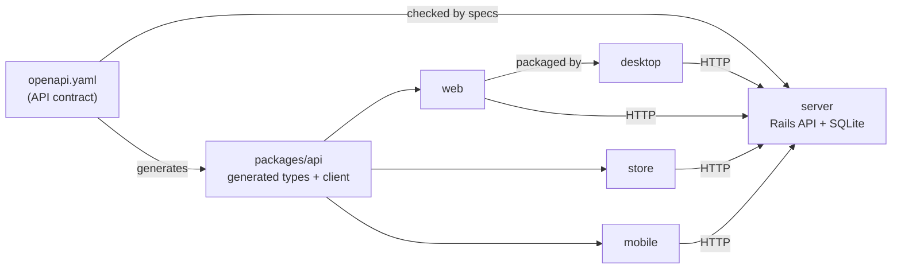

# monorepo-release-lab

An experiment. **One Git tag** (for example `v1.0.0`) releases several apps that share one Rails API.

- How releases work: [RELEASE.md](RELEASE.md)
- What was tested, and what was not: [VERIFICATION.md](VERIFICATION.md)
- Exercises: [exercises/](exercises/)

## Run it with Docker

```sh
docker compose up --build
```

| App | URL |
| --- | --- |
| API | http://localhost:3000/posts |
| web (staff) | http://localhost:8090 |
| store (blog) | http://localhost:8091 |
| marketing | http://localhost:8092 |
| docs | http://localhost:8093 |
| support | http://localhost:8094 |

- The API must use port 3000. If another program uses it, stop that program first.
- The database is seeded on first start. `docker compose down -v` deletes it.
- Code changes need `docker compose up --build` again. For live reload, run the apps without Docker.
- Mobile and desktop do not run in Docker. Start them with the commands below.

## Run it without Docker

You need Ruby 3.4.5, Bun 1.2.21, Node.js 22.12 or later, and SQLite.

```sh
bun install
(cd apps/server && bundle install && bin/rails db:prepare)
```

Run each app in its own terminal, from the repository root:

| App | Command | URL |
| --- | --- | --- |
| server | `cd apps/server && bin/rails server` | http://localhost:3000 |
| web | `bun run --cwd apps/web dev` | http://localhost:5173 |
| store | `bun run --cwd apps/store dev` | http://localhost:5174 |
| desktop | `bun run --cwd apps/desktop start` | opens a window |
| mobile | `bun run --cwd apps/mobile start` | scan the QR code with Expo Go |

- For a phone, start Rails with `bin/rails server -b 0.0.0.0`.
- If `ELECTRON_RUN_AS_NODE=1` is set in your shell, unset it before you start desktop.

## What is in the repository



| Path | What it is |
| --- | --- |
| `apps/server` | Rails API with posts and comments. Owns `openapi.yaml`. |
| `apps/web` | Staff app (React, Vite, TanStack). Create and edit posts. |
| `apps/store` | Public blog. Same stack. Read posts and add comments. |
| `apps/mobile` | Expo app. Read posts and add comments. |
| `apps/desktop` | Electron wrapper. Loads the hosted web app when a web URL is set, or the bundled web build. |
| `apps/marketing`, `apps/docs`, `apps/support` | One static HTML page each. |
| `packages/api` | Generated API types and a typed client. |
| `.github/workflows` | CI and release workflows. |

JavaScript apps share one Bun workspace (`package.json`, `bun.lock`). Rails uses its own `Gemfile`.

## Configuration

The API has no authentication, and no client contains secrets.

| Setting | Where | Default |
| --- | --- | --- |
| API URL for web and store | `public/config.js`, read at runtime | `http://localhost:3000` |
| Web app for desktop | `WEB_URL` environment variable, or `DESKTOP_WEB_URL` when `release.yml` packages it | the bundled copy of the web build |
| API URL for desktop (bundled copy only) | `API_URL` environment variable | `http://localhost:3000` |
| API URL for mobile | `EXPO_PUBLIC_API_URL` | the computer running Expo, port 3000 |
| Allowed browser origins | `CORS_ORIGINS` on the server | `*` |
| Database file | `DATABASE_PATH` on the server | `storage/development.sqlite3` |
| Production secret | `SECRET_KEY_BASE` on the server | none (required in production) |

## Change the API

`apps/server/openapi.yaml` is the single source of the API types.

```sh
# 1. Edit openapi.yaml and the Rails code
(cd apps/server && bundle exec rspec)   # 2. Specs check real responses against the contract
bun run contract:types                  # 3. Regenerate packages/api types
bun run typecheck                       # 4. Type-check web, store, and mobile
```

CI runs these checks on every change. It also fails a pull request if the contract breaks compatibility with the last stable release. CI checks every app every time. The one exception is the server container build: on a PR, it runs only when `apps/server` changes, because the image is built from that folder alone. CI does not work out which apps a change affects.

### What the checks cannot tell you

- **Type checks cover only this repository.** Other code that calls the API is not checked.
- **Old mobile apps still call the API.** Users keep old versions for months, so the server must stay compatible with them.
- **Behavior changes are not caught.** For example, a new sort order keeps the same JSON shape, so every check still passes.
- **A new mobile release does not update every phone.** Store review, staged rollouts, and users who never update all delay it.
