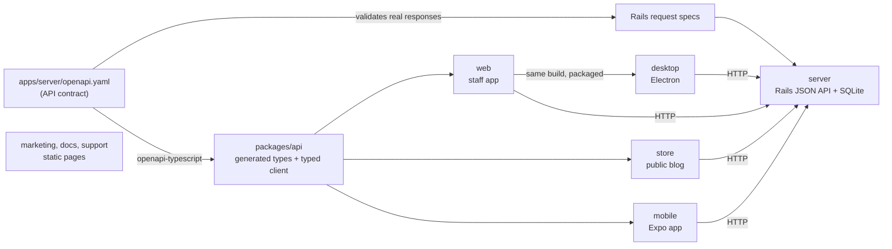

# monorepo-release-lab

An experiment. It shows how **one Git tag** (for example `v1.0.0`) releases several apps that share one Rails API but build and deploy in different ways.

The apps are real and work. The styling is deliberately minimal.

- Release process, previews, candidates, hotfixes, and data checks: [RELEASE.md](RELEASE.md)
- Exercises: [exercises/](exercises/)

## Architecture



| Path | What it is |
| --- | --- |
| `apps/server` | Rails 8.1 API. Tables: `posts` (title, body) and `comments` (post_id, body). Owns `openapi.yaml`. |
| `apps/web` | Staff app. React, Vite, TanStack Router (hash URLs), TanStack Query. Create and edit posts, read comments. |
| `apps/store` | Public blog. Same stack. List posts, show a post, add a comment. |
| `apps/mobile` | Expo + Expo Router + TanStack Query. List posts, show a post, add a comment. |
| `apps/desktop` | Electron. Packages the `apps/web` build. Has no screens of its own. |
| `apps/marketing`, `apps/docs`, `apps/support` | One static HTML page each. |
| `packages/api` | The only shared package: generated types (`src/schema.d.ts`) and a typed client with TanStack Query options. |
| `.github/workflows` | CI, release, preview, deploy, and mobile workflows. See [RELEASE.md](RELEASE.md#workflows). |
| `exercises` | The contract-break exercise, the hotfix demo, and the data-check rehearsal. |
| `scripts/release-manifest.ts` | Writes the release manifest and notes in the release workflow. |

JavaScript apps use Bun workspaces (`package.json`, `bun.lock`). Rails keeps its own `Gemfile`.

## Prerequisites

| Tool | Version used here | Needed for |
| --- | --- | --- |
| Ruby | 3.4.5 (see `apps/server/.ruby-version`) | server |
| Bun | 1.2.21 | all JavaScript apps |
| Node.js | 22.12 or later (24 used here) | Expo CLI, Electron tooling |
| SQLite | 3.x | server |
| Docker | any recent | server container, contract comparison (`oasdiff`) |
| Expo Go, iOS Simulator, or Android Emulator | optional | running the mobile app |

## Set up

```sh
bun install
cd apps/server
bundle install
bin/rails db:prepare   # creates the SQLite database and loads seed data (3 posts, 3 comments)
```

## Start the apps

Run each command in its own terminal, from the repository root.

| App | Command | URL |
| --- | --- | --- |
| server | `cd apps/server && bin/rails server` | http://localhost:3000 |
| web (staff) | `bun run --cwd apps/web dev` | http://localhost:5173 |
| store (blog) | `bun run --cwd apps/store dev` | http://localhost:5174 |
| desktop | `bun run --cwd apps/desktop start` | opens a window |
| mobile | `bun run --cwd apps/mobile start` | scan the QR code, or press `i` / `a` |
| marketing, docs, support | `bun run --cwd apps/docs build && bunx serve apps/docs/dist` | printed by `serve` |

Notes:

- For a physical phone, start Rails with `bin/rails server -b 0.0.0.0`. The phone and the computer must be on the same network.
- If your shell sets `ELECTRON_RUN_AS_NODE=1` (some editors do), unset it before you start the desktop app.

## Configuration

Nothing secret is built into any client. The API has no authentication.

| Setting | Where | Default | Notes |
| --- | --- | --- | --- |
| API URL for web and store | `public/config.js`, read at runtime | `http://localhost:3000` | Deployment replaces this file. The JavaScript build stays the same. |
| API URL for desktop | `API_URL` environment variable when the app starts | `http://localhost:3000` | Set by `apps/desktop/preload.js`. |
| API URL for mobile | `EXPO_PUBLIC_API_URL` (shell, `.env`, or `eas.json` profile) | in development: the computer running the Expo bundler, port 3000 | Android Emulator: `http://10.0.2.2:3000`. The value is compiled into the app and is public. See `apps/mobile/.env.example`. |
| Allowed browser origins | `CORS_ORIGINS` on the server | `*` | Comma-separated list. |
| Database file | `DATABASE_PATH` on the server | `storage/development.sqlite3` | Use a different file for an isolated preview or candidate. |
| Production secret | `SECRET_KEY_BASE` on the server | none | Required in production. The repository has no encrypted credentials file. |
| HTTPS redirect | `RAILS_FORCE_SSL`, `RAILS_ASSUME_SSL` | `true` | Set both to `false` only for a local container over plain HTTP. |

## API contract

`apps/server/openapi.yaml` is the single source of the API types.

1. Rails request specs call `assert_schema_conform` (from `committee-rails`). Each spec checks the real request and response against the contract.
2. `bun run contract:types` generates `packages/api/src/schema.d.ts` with `openapi-typescript`.
3. `packages/api/src/index.ts` builds a typed client with `openapi-fetch` and exposes TanStack Query options. It takes all types from the generated file. There are no handwritten API types.
4. CI regenerates the types and type-checks **web, store, and mobile** against them. The web check also covers the desktop renderer.
5. On pull requests, CI compares the contract with the contract in the last stable tag and fails on breaking changes.

To change the API:

```sh
# edit apps/server/openapi.yaml and the Rails code
(cd apps/server && bundle exec rspec)
bun run contract:types
bun run typecheck
```

CI checks every consumer on every change. It does not try to work out which apps a change affects.

### Contract-break exercise

`bash exercises/contract-break/run.sh` applies the patches in `exercises/contract-break/`, runs each check, and restores the files afterward. It needs a clean `apps/` and `packages/`.

| Step | Change | Check | Result |
| --- | --- | --- | --- |
| 1 | None. Mobile shows `post.title`. | Rails contract specs, mobile typecheck | pass, pass |
| 2 | `01-response-drops-title.patch`: Rails stops sending `title`. The contract still requires it. | Rails contract specs | **fail**: `#/components/schemas/Post missing required parameters: title` |
| 3 | `02-contract-drops-title.patch`: remove `title` from the `Post` schema (and the spec expectations), then regenerate types. | Rails contract specs; mobile, web, store typecheck | pass; **fail**: `error TS2339: Property 'title' does not exist on type '{ id: number; body: string; ... }'` |
| 4 | `03-fix-mobile.patch`: mobile shows `Post #id` instead. | mobile typecheck | pass |
| 4b | `04-fix-web-and-store.patch`: the same fix for web and store. | web, store typecheck | pass |
| Extra | Compare the changed contract with the committed one using `oasdiff`. | `oasdiff breaking --fail-on ERR` | **fail**: 4 × `response-required-property-removed` |

The full output is in [Verification](#verification).

### What the checks cannot tell you

- **Type checks cover only the code that is checked.** They prove that this commit's web, store, and mobile code agree with this commit's contract. They say nothing about other code that calls the API.
- **Old mobile apps still call the API.** Users keep old versions installed for months. The server must stay compatible with every mobile version still in use, not just the newest one. This is why CI compares against the last *stable* contract.
- **A behavior change can break an app without changing the JSON shape.** Examples: sorting comments newest-first instead of oldest-first, or returning an empty `body` where the app expects text. The contract and the types stay the same, and the checks still pass.
- **Publishing a new mobile app does not update every phone.** Store review, staged rollouts, and users who never update all delay adoption. EAS Update reaches only builds with a matching runtime version.

## Verification

All commands ran on Linux x86_64 on 2026-10-14, from a clean commit.

| Check | Command | Result |
| --- | --- | --- |
| Rails API and contract specs | `cd apps/server && bin/rails db:test:prepare && bundle exec rspec` | `19 examples, 0 failures` |
| Generated types are current | `bun run contract:types && git diff --exit-code packages/api/src/schema.d.ts` | no difference |
| Type checks (api, web, store, mobile) | `bun run typecheck` | all 4 exit with code 0 |
| Web builds (web, store, marketing, docs, support) | `bun run build` | all exit with code 0 |
| Mobile bundles (iOS and Android Hermes bytecode) | `bun run --cwd apps/mobile build` | `entry-….hbc` for `ios` (2.5 MB) and `android` (2.9 MB) |
| Mobile project health | `cd apps/mobile && bunx expo-doctor` | `21/21 checks passed` |
| Mobile runtime version is stable across tags | `RELEASE_TAG=v1.0.0` and `v1.0.1` with `bunx expo-updates fingerprint:generate --platform android` | same hash for both tags |
| Desktop package (Linux) | `bun run --cwd apps/desktop pack` and `bunx electron-builder --linux AppImage` | `linux-unpacked/` and `release-lab-staff-<version>-linux-x86_64.AppImage` (125 MB) |
| Server container | `docker build -t release-lab-server:local apps/server` | built (445 MB) |
| Server container sequence | `db:migrate`, `db:seed`, then `rails server` on a fresh volume | `/up` 200; `/posts` returns 3 seeded posts; CORS allows only `CORS_ORIGINS` |
| Browser smoke test (Playwright, against Rails) | web: create (blank title rejected), edit, read comments. store: list, show, comment (blank comment rejected), deep-link reload, 404 page, API-down page | all passed, no page errors |
| Desktop smoke test | packaged app started headless with `API_URL=http://localhost:3300`, inspected over DevTools | loaded posts and comments from that API |
| Local release candidate | server image with `DB_PREPARE_ON_BOOT=true` on its own volume; released web and store tarballs served with a replaced `config.js` | API seeded; store deep link worked; staff app used the candidate API |
| Contract-break exercise | `bash exercises/contract-break/run.sh` | every step as expected (output below) |
| Hotfix demo | `bash exercises/hotfix/demo.sh` | v1.0.1 excludes the unreleased main commit; main contains the fix |
| Data-check rehearsal | see [RELEASE.md](RELEASE.md#manual-database-preparation) | migration blocked before repair, applied after |
| Release manifest | `scripts/release-manifest.ts` with real local artifacts for `v1.0.0-rc.1` | manifest and notes written; macOS and Windows desktop marked `missing`, exit code 1 |
| Workflow syntax | `docker run --rm -v "$PWD:/repo" -w /repo rhysd/actionlint:latest` | no findings |

Contract-break exercise output:

```text
Step 1. Baseline: mobile reads post.title
         apps/mobile/app/index.tsx:24:            <Text style={{ fontSize: 18 }}>{post.title}</Text>
         apps/mobile/app/posts/[id].tsx:55:      <Stack.Screen options={{ title: post.data.title }} />
         apps/mobile/app/posts/[id].tsx:56:      <Text style={{ fontSize: 22, fontWeight: "bold" }}>{post.data.title}</Text>
  PASS Rails contract specs                             (as expected)
  PASS mobile typecheck                                 (as expected)
Step 2. Rails stops sending title, but the contract still requires it
  FAIL Rails contract specs                             (as expected)
         #/components/schemas/Post missing required parameters: title
Step 3. Remove title from the contract and regenerate types
  PASS Rails contract specs                             (as expected)
  FAIL mobile typecheck                                 (as expected)
         app/index.tsx(24,50): error TS2339: Property 'title' does not exist on type '{ id: number; body: string; created_at: string; updated_at: string; }'.
         app/posts/[id].tsx(55,49): error TS2339: Property 'title' does not exist on type '{ id: number; body: string; created_at: string; updated_at: string; }'.
         app/posts/[id].tsx(56,69): error TS2339: Property 'title' does not exist on type '{ id: number; body: string; created_at: string; updated_at: string; }'.
  FAIL web typecheck (desktop renderer)                 (as expected)
         src/router.tsx(141,37): error TS2339: Property 'title' does not exist on type '{ id: number; body: string; created_at: string; updated_at: string; }'.
         src/router.tsx(53,21): error TS2339: Property 'title' does not exist on type '{ id: number; body: string; created_at: string; updated_at: string; }'.
  FAIL store typecheck                                  (as expected)
         src/router.tsx(40,21): error TS2339: Property 'title' does not exist on type '{ id: number; body: string; created_at: string; updated_at: string; }'.
         src/router.tsx(98,22): error TS2339: Property 'title' does not exist on type '{ id: number; body: string; created_at: string; updated_at: string; }'.
Step 4. Fix the mobile consumer
  PASS mobile typecheck                                 (as expected)
  Web and store read title too. CI checks every consumer, so fix them as well:
  PASS web typecheck (desktop renderer)                 (as expected)
  PASS store typecheck                                  (as expected)
Extra. Compare the proposed contract with the last stable contract
  FAIL oasdiff breaking-change check                    (as expected)
         error	[response-required-property-removed] at /proposed.yaml

Every step behaved as expected. Restoring the original files.
```

## Not built or not verified

| Item | Status | Why |
| --- | --- | --- |
| GitHub Actions runs | **Not run.** Checked with `actionlint` only. | No push was allowed. The first real run may expose runner differences. |
| macOS `.dmg` and Windows `.exe` desktop installers | **Not built.** | They need macOS and Windows runners. The release workflow builds them there. |
| Desktop code signing and notarization | **Not configured.** Packages are unsigned. | No certificates. |
| Mobile app in a simulator or on a device | **Not run.** Type check, `expo-doctor`, and bundle export passed. | No simulator or device on this machine. |
| EAS Build, EAS Update, and store submission | **Not configured.** | Needs an Expo account (`EXPO_TOKEN`, `EAS_PROJECT_ID`) and store accounts. |
| Container push to GHCR | **Not run.** | It runs only inside the release workflow. |
| Hosted deployment (server, web sites) | **Not configured.** The deploy jobs stop with `NOT DEPLOYED`. | No host, SSH key, or domain. |
| Production approval gate | **Defined, not enforced.** | Required reviewers must be set on the `production` environment in GitHub settings. |
| PR preview workflow | **Not run.** Its steps were run locally. | Needs GitHub. |
