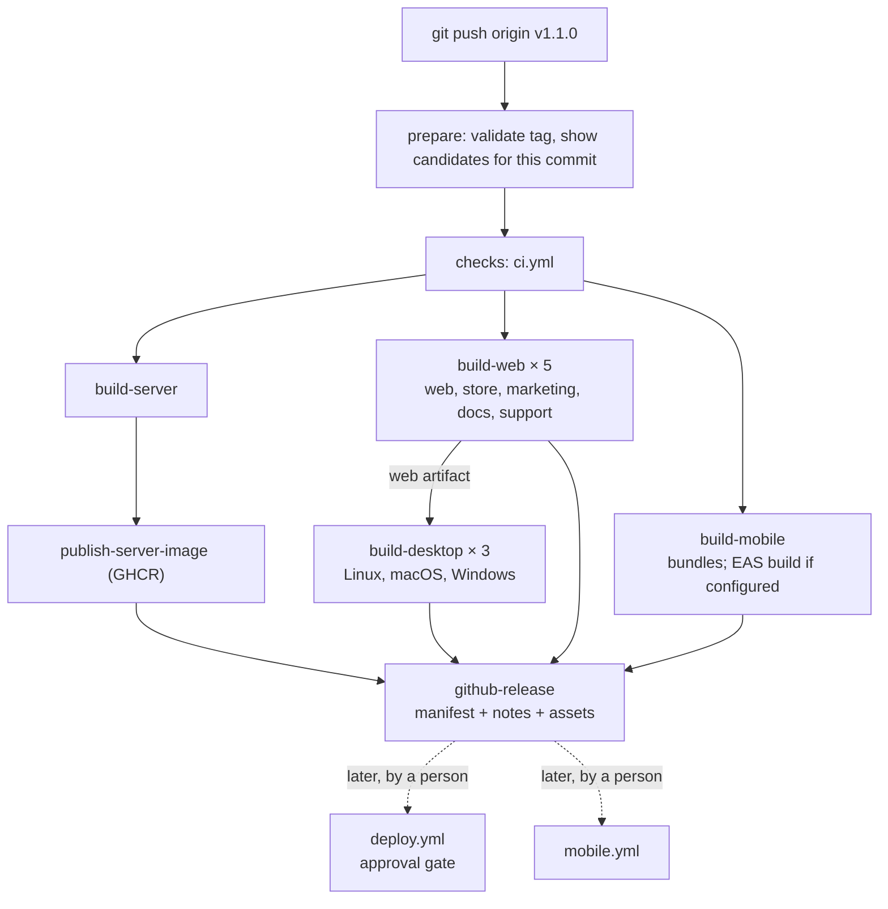

# Release process

One repository Git tag releases every app. This file explains tags, workflows, previews, candidates, stable releases, hotfixes, and manual data checks.

Nothing here has been pushed, tagged on a remote, published, or deployed. The commands show what a maintainer runs.

## Contents

- [Three kinds of build](#three-kinds-of-build)
- [Version numbers](#version-numbers)
- [Workflows](#workflows)
- [Build once, promote the same artifact](#build-once-promote-the-same-artifact)
- [PR previews](#pr-previews)
- [Release candidates](#release-candidates)
- [Stable releases](#stable-releases)
- [Optional weekly schedule](#optional-weekly-schedule)
- [Hotfixes](#hotfixes)
- [Server migration and deployment sequence](#server-migration-and-deployment-sequence)
- [Mobile delivery](#mobile-delivery)
- [API contract changes](#api-contract-changes)
- [Manual database preparation](#manual-database-preparation)
- [External setup still needed](#external-setup-still-needed)

## Three kinds of build

| | PR preview | Release candidate | Stable release |
| --- | --- | --- | --- |
| What it is | A temporary build of one proposed change | A selected commit from `main` that is under test | An approved repository version |
| Identified by | PR number and commit SHA | Tag `vX.Y.Z-rc.N` (for example `v1.1.0-rc.1`) | Tag `vX.Y.Z` (for example `v1.1.0`) |
| Started by | Adding the `preview` label to a PR, then every push to that PR | A person pushes the candidate tag | A person pushes the stable tag |
| Output | Workflow artifacts kept 7 days | GitHub **pre-release**, `candidate` channels | GitHub Release, production channels allowed |
| Can reach production users | No | No | Only after the approved **Deploy** and **Mobile** workflows |

Merging into `main` runs CI only. It never deploys anything.

## Version numbers

The repository tag is the release version. Some platforms need their own numbers too. Do not confuse them.

| Number | Example | Where it comes from | Used for |
| --- | --- | --- | --- |
| **Repository tag** | `v1.1.0`, `v1.1.0-rc.1` | `git tag` | The release of every app. Recorded in the manifest. |
| Desktop app version | `1.1.0-rc.1` | The tag without `v`, set at packaging time | The installer file name and the version the OS shows |
| Mobile store version | `1.1.0` | The tag without `v` and without `-rc.N` (`apps/mobile/app.config.ts`) | App Store and Google Play. Stores do not accept `-rc.1`. |
| Mobile build number | `42` | EAS, increased on each production build (`appVersionSource: remote`) | Stores need a new number for every upload. It is **not** a release tag. |
| Mobile runtime version | `cc8d910e…` | Fingerprint of native code and config (`runtimeVersion: fingerprint`) | Decides which installed builds can take an EAS Update |
| Web `version.json` | `{"tag": "v1.1.0", "commit": "…"}` | Written by the release workflow | Lets you check which release a host serves |

There are no separate Git tags for mobile, desktop, or the websites.

## Workflows

| File | Trigger | What it does | Publishes or deploys? |
| --- | --- | --- | --- |
| `ci.yml` | Pull request, push to `master`, called by `release.yml` | Four jobs: `server`, `js`, `server-image`, and `CI passed`. Together they run Rails specs with contract validation; generated types are current; type checks for web, store, and mobile; builds of every web app; mobile bundle export; Linux desktop package; server container build; on PRs, a breaking-change check against the last stable contract | No |
| `release.yml` | Push of a tag `v*` | Validates the tag, runs `ci.yml`, builds each app in its own job from the tagged commit, pushes the server image to GHCR, writes the manifest, creates one GitHub Release | GitHub Release and container image only. **No deployment.** |
| `preview.yml` | Pull requests with the `preview` label (every push), or manual with a PR number | Builds every app from the PR head and uploads test artifacts | No |
| `deploy.yml` | Manual, with a tag, an environment, and the apps to deploy | Checks the manifest, waits at the approval gate, backs up and migrates the database, starts the server, then deploys the chosen web sites | Yes, after approval. Fails with `NOT DEPLOYED` if hosting is not configured. |
| `mobile.yml` | Manual, with a tag | Sends an EAS Update, or submits an EAS build to a store testing track | Yes, after approval for production. Fails with `NOT PUBLISHED` if EAS is not configured. |



Every job checks out `github.sha`, the commit the tag pointed to when it was pushed. For the first experiment, every release builds every app. There is no affected-app detection.

### The release manifest

`release-manifest.json` is attached to each GitHub Release. It records:

- the Git tag and the source commit SHA,
- the channel (`candidate` or `stable`),
- for each app: the build result, artifact file names with SHA-256 checksums, any platform version, and the publication status.

Publication status is one of `published`, `started`, `not-configured`, `not-applicable`, or `failed`. A missing step is never shown as a success. If any build fails or is missing, the workflow uploads the manifest as a workflow artifact, creates **no** GitHub Release, and fails.

To try the manifest script locally:

```sh
RELEASE_TAG=v1.0.0-rc.1 RELEASE_SHA=$(git rev-parse HEAD) bun scripts/release-manifest.ts <status-dir> <out-dir>
```

A local run with real artifacts for every Linux-buildable app produced this summary. macOS and Windows desktop packages cannot be built on Linux, so the script refused to call the release complete:

```text
  server           build=success publication=not-configured
  web              build=success publication=not-configured
  store            build=success publication=not-configured
  marketing        build=success publication=not-configured
  docs             build=success publication=not-configured
  support          build=success publication=not-configured
  desktop-linux    build=success publication=not-configured
  desktop-macos    build=missing publication=failed
  desktop-windows  build=missing publication=failed
  mobile           build=success publication=not-configured
At least one build did not succeed. Do not publish this release.
```

## Build once, promote the same artifact

Within one tag, each artifact is built once. Environments receive that same artifact.

| App | Built once? | How the environment is chosen |
| --- | --- | --- |
| server | Yes. One image per tag, pushed to GHCR. | Runtime environment variables (`/etc/release-lab/<env>/server.env`). |
| web, store | Yes. One tarball per tag. | `config.js` is replaced at deploy time. The JavaScript files do not change. |
| marketing, docs, support | Yes. | No configuration. |
| desktop | Yes. Packages the released **web** tarball, not a new web build. | With `DESKTOP_WEB_URL` set at packaging time, the app loads the hosted web app, so it follows each web deploy without a new installer. Without it, the app loads the bundled copy and reads `API_URL` when it starts. |
| mobile | **No. One build per environment.** | `EXPO_PUBLIC_API_URL` is compiled into the JavaScript bundle. Each `eas.json` profile (`preview`, `candidate`, `production`) is a separate build with its own URL and update channel. |

When a separate build is required:

- **Values compiled into the code.** Expo inlines `EXPO_PUBLIC_*` values at build time, so each mobile environment needs its own build. A web app with `import.meta.env` values would have the same problem, which is why web and store read `config.js` at runtime instead.
- **Versions embedded in the package.** The desktop installer and the mobile store version include the version number. Promoting `v1.1.0-rc.1` to `v1.1.0` therefore rebuilds every app from **the same commit** under the new tag. The manifests of both tags record the commit SHA, so you can confirm that they match. Server and web artifacts differ only in their labels and `version.json`.

## PR previews

A PR preview is temporary. It is not a release and has no tag.

**In GitHub (hosting not configured):** add the `preview` label to a pull request. The **PR preview** workflow then runs at once and on every later push to that PR. Remove the label to stop. PRs without the label build no preview. A newer push cancels the older run. It builds every app from `refs/pull/<N>/head` and uploads the `preview-pr-<N>` artifact (kept 7 days). It uses no secrets, because PR code can come from anyone. Download it with `gh run download <run-id> -n preview-pr-<N>`. To rebuild by hand, run **Actions → PR preview → Run workflow** with the PR number.

**Locally, with an isolated database:**

```sh
git fetch origin pull/123/head:pr-123
git worktree add ../lab-pr-123 pr-123
cd ../lab-pr-123
bun install
cd apps/server && bundle install
DATABASE_PATH=storage/preview-pr-123.sqlite3 bin/rails db:prepare
DATABASE_PATH=storage/preview-pr-123.sqlite3 bin/rails server -p 3200
# in another terminal, from ../lab-pr-123
echo 'window.APP_CONFIG = window.APP_CONFIG || { apiUrl: "http://localhost:3200" };' > apps/store/public/config.js
bun run --cwd apps/store dev
```

Remove it afterward with `git worktree remove ../lab-pr-123`. The preview database is a separate file, so it never touches your development data.

## Release candidates

A candidate is a specific commit from `main` that you want to test as a whole.

```sh
git switch main && git pull
git tag -a v1.1.0-rc.1 -m "Release candidate v1.1.0-rc.1"
git push origin v1.1.0-rc.1        # starts release.yml
```

`release.yml` creates a GitHub **pre-release**. Candidate rules:

- Mobile builds use the EAS `candidate` profile and channel, never `production`.
- `deploy.yml` refuses to send a candidate tag to `production`.
- `mobile.yml` refuses to send a candidate tag to the `production` channel or to a store.

**Run a candidate locally with an isolated database.** These commands were tested with a local `v1.0.0-rc.1` build:

```sh
# Server: the candidate image on its own volume. The volume is the isolated database.
docker run -d --rm --name lab-rc -p 3100:3000 \
  -e SECRET_KEY_BASE=local-candidate-only \
  -e RAILS_FORCE_SSL=false -e RAILS_ASSUME_SSL=false \
  -e DB_PREPARE_ON_BOOT=true \
  -e CORS_ORIGINS=http://localhost:4100,http://localhost:4101 \
  -v lab-rc-1-storage:/rails/storage \
  ghcr.io/<owner>/release-lab-server:v1.1.0-rc.1

# Web and store: the released tarballs, with only config.js replaced.
gh release download v1.1.0-rc.1 -p 'web-*' -p 'store-*'
for app in web store; do
  mkdir -p "rc/$app" && tar -xzf "$app-v1.1.0-rc.1.tar.gz" -C "rc/$app"
  echo 'window.APP_CONFIG = window.APP_CONFIG || { apiUrl: "http://localhost:3100" };' > "rc/$app/config.js"
done
bunx serve rc/web -l 4100          # staff app
bunx serve -s rc/store -l 4101     # blog (-s sends unknown paths to index.html)

# Clean up
docker rm -f lab-rc && docker volume rm lab-rc-1-storage
```

Without GitHub, build the image yourself from a worktree: `git worktree add ../lab-rc v1.1.0-rc.1 && docker build -t release-lab-server:v1.1.0-rc.1 ../lab-rc/apps/server`.

If testing finds a problem, fix it on `main` and tag `v1.1.0-rc.2`. Never move an existing tag.

## Stable releases

Promote a candidate by tagging **the same commit** as the stable version:

```sh
git tag -a v1.1.0 -m "Release v1.1.0" v1.1.0-rc.2^{commit}
git push origin v1.1.0
```

The `prepare` job lists the candidate tags on that commit. It warns if there are none.

The stable release is still not deployed. To deploy, run **Actions → Deploy** with the tag and `production`. A required reviewer must approve it.

### Deploy only the apps that changed

Every tag builds every app, but you choose what to deploy. Set the `apps` input of **Deploy** to a comma-separated list, for example `server` or `web,store`. The default is `all`. Apps you leave out keep running their current tag.

| The release changed | `apps` | Then |
| --- | --- | --- |
| Mobile only | do not run **Deploy** | Run **Mobile** only |
| Server only | `server` | |
| Store only | `store` | |
| Server and web | `server,web` | Server deploys first, then web |

The workflow does not check your choice. It cannot tell which apps a change affects. Compare the tags yourself, for example `git diff --stat v1.0.0 v1.1.0 -- apps packages`. A change in `packages/api` affects web, store, and mobile. If you are unsure, deploy `all`. Redeploying an unchanged app is safe.

## Optional weekly schedule

This is a habit, not automation. Nothing becomes stable because the week has ended.

1. **Monday:** pick the newest green commit on `main`. Tag it `vX.Y.0-rc.1` and push the tag.
2. **During the week:** deploy the candidate to the `candidate` environment and test it. Send mobile testers the candidate build. If you fix something, tag `rc.2` from `main`.
3. **When ready:** tag the tested candidate commit as `vX.Y.0`. Deploy it to production through the approval gate.
4. **If checks fail or time runs out:** do not tag a stable release. Production stays on the previous stable version. The candidate stays a pre-release, and the next week starts with a new candidate.

## Hotfixes

Scenario: production runs `v1.0.0`. `main` has newer work that cannot ship yet. A bug must be fixed now.

```sh
# 1. Branch from the production tag, not from main
git switch -c hotfix/v1.0.1 v1.0.0

# 2. Fix the bug and run the relevant checks
git apply exercises/hotfix/fix-comment-whitespace.patch    # or edit the code
(cd apps/server && bin/rails db:test:prepare && bundle exec rspec spec/models/comment_spec.rb spec/requests/comments_spec.rb)
git commit -am "Strip whitespace around comment bodies"

# 3. Tag the corrected commit and push. The normal release workflow builds v1.0.1.
git tag -a v1.0.1 -m "Release v1.0.1"
git push origin hotfix/v1.0.1 v1.0.1

# 4. Bring the fix back into main
git switch main
git merge --no-ff hotfix/v1.0.1 -m "Merge hotfix v1.0.1 into main"
git push origin main
```

What each tag identifies:

- `v1.0.0` identifies the commit that production runs.
- `v1.0.1` identifies the fix commit on `hotfix/v1.0.1`. Its parent is the `v1.0.0` commit, so the build contains `v1.0.0` plus the fix and **none** of the newer `main` commits.
- `main` then gets a merge commit that contains both the newer work and the fix. No tag points at it until the next release.

`bash exercises/hotfix/demo.sh` runs this scenario in a throwaway clone. Real output (commit hashes change on each run):

```text
== 1. Production is v1.0.0
$ git tag -a v1.0.0 -m Release v1.0.0

== 2. main gets newer work that is not ready to ship
$ git commit -q -am Add teaser for unfinished post tags feature

== 3. Create the hotfix branch from the production tag, not from main
$ git switch -q -c hotfix/v1.0.1 v1.0.0

== 4. Fix the bug and run the relevant checks
$ git apply /home/kennedywee/Work/kennedywee/monorepo-release-lab/exercises/hotfix/fix-comment-whitespace.patch
$ bin/rails db:test:prepare
$ bundle exec rspec spec/models/comment_spec.rb spec/requests/comments_spec.rb
.........

Finished in 0.05791 seconds (files took 0.41196 seconds to load)
9 examples, 0 failures

$ git commit -q -am Strip whitespace around comment bodies

== 5. Tag the corrected commit
$ git tag -a v1.0.1 -m Release v1.0.1
In a real repository: git push origin hotfix/v1.0.1 v1.0.1
That push starts the normal Release workflow for v1.0.1. (Not run in this demo.)

== 6. Bring the fix back into main
$ git switch -q main
$ git merge -q --no-ff hotfix/v1.0.1 -m Merge hotfix v1.0.1 into main

== Result
*   5a4c750 Merge hotfix v1.0.1 into main (HEAD -> main)
|\  
| * 3047efe Strip whitespace around comment bodies (tag: v1.0.1, hotfix/v1.0.1)
* | 53d1139 Add teaser for unfinished post tags feature
|/  
* d2d7286 Show only the hotfix commits in the demo graph (tag: v1.0.0)

v1.0.0 identifies commit d2d7286: Show only the hotfix commits in the demo graph
v1.0.1 identifies commit 3047efe: Strip whitespace around comment bodies
main is at commit 5a4c750: Merge hotfix v1.0.1 into main

OK: v1.0.1 does not contain the unreleased main commit 53d1139.
OK: main contains the v1.0.1 fix.
Files that differ between v1.0.0 and v1.0.1:
   apps/server/app/models/comment.rb       | 2 ++
   apps/server/spec/models/comment_spec.rb | 4 ++++
   2 files changed, 6 insertions(+)
```

## Server migration and deployment sequence

`deploy.yml` follows these steps. The container does **not** migrate on boot (`DB_PREPARE_ON_BOOT` is off by default).

1. **Approval gate.** For production, a required reviewer approves the `production` environment. If the release needs manual data preparation, the reviewer checks the runbook record first.
2. **Pull** the image for the tag from GHCR. This is the image the release built and tested.
3. **Back up** the SQLite database: `sqlite3 production.sqlite3 ".backup backup-before-<tag>.sqlite3"`.
4. **Migrate** in a one-off container from the new image: `bin/rails db:migrate`.
5. **Replace** the running container with the new image.
6. **Smoke test:** `GET /up` returns 200, and `GET /posts` returns a JSON array.
7. **Deploy the web sites.** Upload each tarball to `/srv/release-lab/<env>/<app>/<tag>/`, write `config.js`, then point the `current` symlink at it.

Rollback: point `current` back at the previous tag's folder, and start the previous image. A migration that removed or changed data cannot be undone this way. Restore the backup instead. Keep migrations backward compatible (add first, remove in a later release), because old mobile apps and the previous server version may still run against the new schema.

## Mobile delivery

**JavaScript update or new binary?**

| Change | How it ships | Why |
| --- | --- | --- |
| Screens, text, API calls, bug fixes in TypeScript | `mobile.yml` → `update` (EAS Update) | The runtime version (fingerprint) does not change. Installed builds with that runtime download the update. |
| New native module, Expo SDK upgrade, permission, icon, `app.config.ts` native setting | New EAS build, then store submission | The fingerprint changes. Old builds cannot run the new code, and an update will not reach them. |

`mobile.yml` prints the runtime version of the tagged commit. Compare it with the runtime version of the builds in use. The store version from the tag is excluded from the fingerprint (`apps/mobile/fingerprint.config.js`). Without that, every tag would change the runtime, and a JavaScript-only hotfix could not reach older builds. This was checked: tags `v1.0.0` and `v1.0.1` give the same fingerprint.

**Submitting is not releasing.**

1. `release.yml` starts an EAS build (if `EXPO_TOKEN` and `EAS_PROJECT_ID` exist). The build is not on any phone.
2. `mobile.yml` → `submit` uploads the build. Android goes to the **internal** track as a **draft**. iOS goes to App Store Connect / TestFlight. Production users still do not have it.
3. A person releases it in Google Play Console or App Store Connect, after store review, often as a staged rollout.
4. Users install it over days or weeks. Some never update. The API must keep working for older versions.

## API contract changes

1. Change `apps/server/openapi.yaml` and the Rails code in one pull request.
2. Run `bun run contract:types` and commit the regenerated `packages/api/src/schema.d.ts`. CI fails if you forget.
3. CI type-checks web, store, and mobile against the new types.
4. CI compares the contract with the last stable tag using `oasdiff breaking --fail-on ERR`. Removing a response field, a path, or an operation fails. Adding an optional field passes.
5. If a breaking change is intended, add the `breaking-api-change-approved` label. Then confirm that every supported mobile version still works, or plan a minimum-version upgrade.

Try the comparison locally (Docker needed):

```sh
git show v1.0.0:apps/server/openapi.yaml > /tmp/stable.yaml     # use HEAD before the first tag exists
docker run --rm -v /tmp/stable.yaml:/stable.yaml:ro -v "$PWD/apps/server/openapi.yaml:/proposed.yaml:ro" \
  tufin/oasdiff:v1.33.0 breaking /stable.yaml /proposed.yaml --fail-on ERR
```

This check is structural only. See the limits in the [README](README.md#what-the-checks-cannot-tell-you).

## Manual database preparation

Example: release **v1.1.0** adds database check constraints. Titles must be non-blank and at most 200 characters. Comment bodies must be non-blank. The model validations already enforce this, but old imported rows may break it. If they exist, `bin/rails db:migrate` fails with `CHECK constraint failed`.

The migration is `exercises/data-check/20261014130000_add_title_and_body_checks.rb`. It is not on `main`.

### 1. Inspect (read-only)

Open a console on **production**, with the current release still running:

```sh
docker run --rm -it --env-file /etc/release-lab/production/server.env \
  -v release-lab-production-storage:/rails/storage \
  ghcr.io/<owner>/release-lab-server:v1.0.0 ./bin/rails console
```

Paste `exercises/data-check/inspect.rb`. It changes nothing. It finds:

| Finding | Query |
| --- | --- |
| Blank titles | `Post.where("trim(title) = ''")` |
| Titles over 200 characters | `Post.where("length(title) > 200")` |
| Blank comments | `Comment.where("trim(body) = ''")` |
| Comments whose post is gone | `Comment.where.missing(:post)` |

### 2. Decide

| Finding | Decision |
| --- | --- |
| None | **Permit.** Record the output and continue. |
| Blank titles, 10 or fewer | **Repair permitted.** Set the title to `Untitled post #<id>`. |
| Blank titles, more than 10 | **Block.** This points to a bad import. Investigate first. |
| Blank comments | **Repair permitted.** Delete them. They have no content. |
| Titles over 200 characters | **Block.** An editor shortens each title in the staff app. Automatic truncation could change the meaning. |
| Comments without a post | **Block.** This is an integrity problem. Investigate first. |

### 3. Repair

Paste `exercises/data-check/repair.rb` into the same console. It runs in one transaction and prints each change. Save the output in the release record.

The repair is **not** a migration. Migrations change the schema and run on every database, including new ones. Repairs change specific production rows after a person has reviewed them.

### 4. Verify

Paste `inspect.rb` again. Continue only if it prints `READY: no unusual records`.

### 5. Verify again before you deploy

Run `inspect.rb` again right before the approval and the migration. Data keeps changing between preparation and deployment: an import, a console session, or the old code can add new unusual rows. If the result is not `READY`, stop.

### 6. Approval gate

Start `deploy.yml` with `data_preparation: completed-and-verified-on-production` and a link to the record. The `production` reviewer checks the record before approving. The migration runs only after approval.

### Why a candidate database cannot prove production is ready

A candidate runs on seed data, or on a copy taken at some earlier time. It proves that the migration and the repair script work. It cannot prove that production has no other unusual rows, or that no new ones appeared after the copy. Only the inspection on production, repeated just before deployment, shows that.

### Rehearsal

Rehearse with synthetic data on an isolated database:

```sh
cd apps/server
export DATABASE_PATH=storage/rehearsal.sqlite3
bin/rails db:prepare
bin/rails runner ../../exercises/data-check/unusual_records.rb
bin/rails runner ../../exercises/data-check/inspect.rb
cp ../../exercises/data-check/20261014130000_add_title_and_body_checks.rb db/migrate/
bin/rails db:migrate                                   # fails: CHECK constraint failed
# editor shortens the long title (simulated):
bin/rails runner 'Post.find(5).update!(title: "Imported headline")'
bin/rails runner ../../exercises/data-check/inspect.rb
bin/rails runner ../../exercises/data-check/repair.rb
bin/rails runner ../../exercises/data-check/inspect.rb
bin/rails db:migrate                                   # succeeds
# undo the rehearsal
rm db/migrate/20261014130000_add_title_and_body_checks.rb storage/rehearsal.sqlite3 && git checkout db/schema.rb
```

Real output:

```text
Added synthetic unusual records: posts 4 (blank title) and 5 (270-character title), 2 blank comments.
--- inspect (before)
{blank_titles: [4],
 long_titles: [[5, 270]],
 blank_comments: [[4, 4], [5, 5]],
 orphan_comments: []}
BLOCKED: titles over 200 characters need an editor
--- migrate (before repair)
SQLite3::ConstraintException: CHECK constraint failed: posts_title_present_and_short
--- editor shortens post 5 in the staff app (simulated)
post 5 title is now "Imported headline"
--- inspect (after editor fix)
{blank_titles: [4],
 long_titles: [],
 blank_comments: [[4, 4], [5, 5]],
 orphan_comments: []}
REPAIR NEEDED: run the approved repair, then inspect again
--- repair
post 4: title "   " -> "Untitled post #4"
comment 4 on post 4: deleted (body was " ")
comment 5 on post 5: deleted (body was "")
--- inspect (verify)
{blank_titles: [], long_titles: [], blank_comments: [], orphan_comments: []}
READY: no unusual records
--- migrate
== 20261014130000 AddTitleAndBodyChecks: migrated (0.0279s) ===================
```

## External setup still needed

These items are configured in the workflows but need accounts or settings that this repository does not have. Until they exist, the related jobs stop with a clear `NOT DEPLOYED` or `NOT PUBLISHED` error, or record `not-configured` in the manifest.

| Need | Used by | Setting |
| --- | --- | --- |
| GitHub environments `candidate` and `production`, with required reviewers on `production` | `deploy.yml`, `mobile.yml` | Repository settings → Environments |
| `DEPLOY_HOST`, `DEPLOY_USER`, `API_URL` (variables) and `DEPLOY_SSH_KEY` (secret), per environment | `deploy.yml` | Environment variables and secrets |
| A host with Docker, `/etc/release-lab/<env>/server.env`, and a web server for `/srv/release-lab/<env>/<app>/current` | `deploy.yml` | Your infrastructure |
| GHCR package write access | `release.yml` | Works with `GITHUB_TOKEN`. Make the package public, or give the host a pull token. |
| `EXPO_TOKEN` (secret), `EAS_PROJECT_ID` (variable), store credentials in EAS | `release.yml`, `mobile.yml` | Expo account, `eas init` |
| `DESKTOP_WEB_URL` (variable, optional), for example the production web URL. Without it, desktop uses the bundled web build. | `release.yml` | Repository variables |
| `DESKTOP_CSC_LINK`, `DESKTOP_CSC_KEY_PASSWORD` (secrets) | `release.yml` | Code-signing certificates. Notarization on macOS needs more setup. |
| Label `breaking-api-change-approved` | `ci.yml` | Repository labels |
| Label `preview` | `preview.yml` | Repository labels |
| Required status check `CI passed` | `ci.yml` | Repository settings → Branches |
